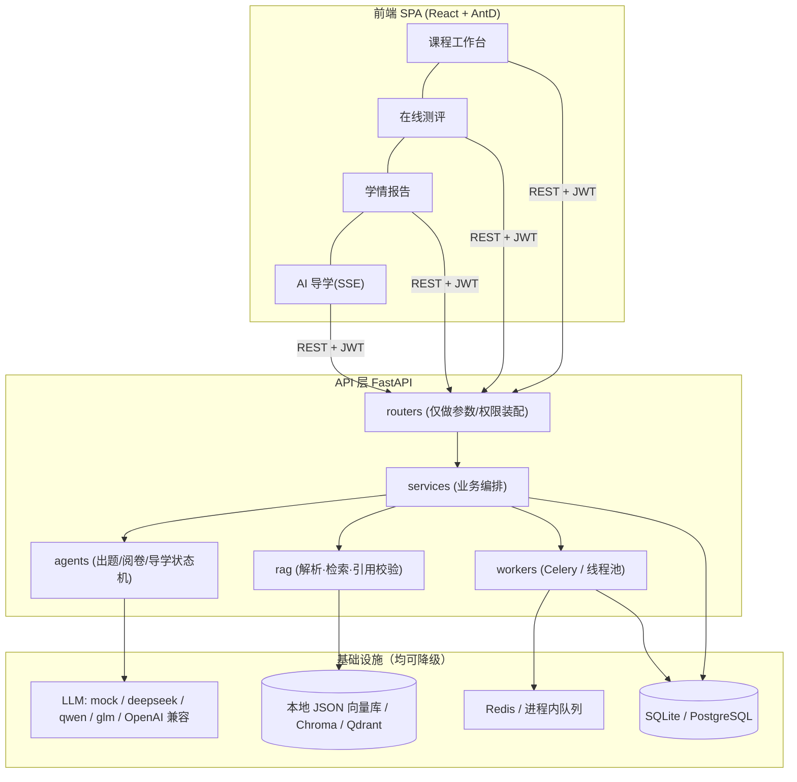

# 智评导学 · 多智能体自主测评与导学系统

> 以课程课件为**唯一事实来源**，由「出题官 / 阅卷官 / 导学师」三个智能体协同完成
> **出题 → 审核 → 组卷 → 作答 → 阅卷 → 学情诊断 → 错题导学** 的教学闭环。
> 每道题、每条讲解都可溯源到课件原文片段（chunk_id + 页码 + 标题路径 + 引文），从机制上抑制大模型幻觉。

- 后端：FastAPI + SQLAlchemy 2.0(async) + Alembic，RAG 自研（解析/清洗/结构感知分块/混合检索/引用校验），智能体编排为自研 LangGraph 兼容状态机
- 前端：Vite + React 18 + TypeScript + Ant Design 5 + React Router + TanStack Query + Zustand
- 部署：`docker compose` 一键起 pg / redis / qdrant / api / worker / web；**无任何外部依赖也能启动**（SQLite + 本地向量 + mock LLM）

---

## 目录

- [1. 功能概览](#1-功能概览)
- [2. 架构](#2-架构)
- [3. 快速开始](#3-快速开始)
- [4. 演示账号与黄金路径](#4-演示账号与黄金路径)
- [5. 关键设计](#5-关键设计)
- [6. 降级矩阵](#6-降级矩阵)
- [7. 测试与评测](#7-测试与评测)
- [8. 目录结构](#8-目录结构)
- [9. 配置项](#9-配置项)
- [10. 已知限制](#10-已知限制)

---

## 1. 功能概览

| 角色 | 能力 |
|---|---|
| 教师 | 建课、上传课件（PDF/PPTX/DOCX/MD/TXT）、查看解析进度与分块原文、知识点树（可一键从课件标题结构抽取）、AI 出题（按知识点/题型/难度）、题库审核（通过/驳回/批量）、自动组卷与发布、班级成绩与错题热力分析 |
| 学生 | 参加测评（断点续答、自动存草稿、倒计时）、查看逐题解析与得分理由、知识点掌握度雷达、错题一键唤起 AI 导学（流式讲解 + 原文溯源） |
| 管理员 | 依赖健康检查、向量索引重建、LLM 调用统计（时延/成功率/token，论文性能数据来源） |

三个智能体的职责边界：

1. **出题官**（`question_graph.py`）：知识点 → 检索原文 → 生成题目草稿 → 结构校验 → 引用校验（不合规自动纠正、纠正失败丢弃）→ 质量自检打分
2. **阅卷官**（`grader_graph.py`）：客观题规则判分；主观题「要点抽取 → 评分细则检索 → 分点给分 → 一致性复评（同模型 temperature=0 二次评分，差值超阈值转人工）」→ 聚合
3. **导学师**（`tutor_graph.py`）：加载错题上下文 → 归因诊断 → 检索原文 → 分层讲解（SSE 流式）→ 引用校验 → 推荐练习；支持追问分支

---

## 2. 架构



更完整的架构图、Agent 时序图、ER 图见 [`docs/architecture/README.md`](docs/architecture/README.md)。

分层约定（强制）：

- **router 不含业务逻辑**，只做参数校验、权限守卫、调用 service、包信封
- **层间不传裸 dict**，跨层用 `app/schemas/*` 的 Pydantic 模型
- **mock 只存在于 `app/adapters/mock/`**，生产代码不得 import mock 实现（由 `get_*` 工厂按配置选择）
- **所有外部依赖必须有降级路径**，任何一项挂掉系统仍能启动并给出可读错误

---

## 3. 快速开始

### 3.1 方式一：Docker（完整栈，推荐用于验收）

```bash
cp .env.example .env                # 按需填 LLM_API_KEY；不填则自动使用 mock 模型
docker compose up -d --build       # postgres + redis + api + worker-io + worker-llm + web
                                   # 数据库迁移由一次性 migrate 服务自动完成（无需手动 alembic）
docker compose exec api python -m app.cli seed --demo   # 演示数据：课程 + 2 份课件 + 题库 + 试卷 + 已判分作答
docker compose ps                  # 全部服务应显示 (healthy)
```

打开：

| 入口 | 地址 |
|---|---|
| 前端 | http://localhost:8080 |
| OpenAPI | http://localhost:8000/docs |
| 健康检查 | http://localhost:8000/health |
| Flower（可选） | `docker compose --profile ops up -d` → http://localhost:5555 |

> **为什么是 8080**：Windows 上 80 端口常被系统进程（`System`/http.sys）占用，容器映射 80 会直接失败，因此 web 统一映射到 8080；如需 80，改 `docker-compose.yml` 里 `web.ports` 即可。
>
> 常用命令：`make logs`（跟踪三服务日志）、`make ps`、`make stop`、`make seed-docker`、`make backup`。
> 本机没有 `make` 时，直接用等价的 `docker compose ...` 命令。


### 3.2 方式二：本机直跑（无需 Docker，默认零依赖）

```bash
cp .env.example .env          # 默认：SQLite + 本地向量库 + hash 向量 + mock LLM

# 后端
python -m venv .venv
.venv/Scripts/python -m pip install -e "backend[dev]"     # Windows
# source .venv/bin/activate && pip install -e "backend[dev]"  # macOS/Linux
cd backend
..\.venv\Scripts\python -m alembic upgrade head
..\.venv\Scripts\python -m app.cli seed --demo
..\.venv\Scripts\python -m uvicorn app.main:app --reload --port 8000

# 前端（另开终端）
cd frontend && npm install && npm run dev     # http://127.0.0.1:5173（已代理 /api → 8000）
```

> 也可以 `make dev-local` 一条命令同时起前后端。
> 若已有可用的大模型，改 `.env` 中 `LLM_PROVIDER=deepseek` 与 `LLM_API_KEY` 即切换为真实模型；
> `EMBEDDING_PROVIDER=api|local` 可切换为真实向量，**换模型后必须执行** `make eval` 之外的 `POST /api/v1/admin/reindex` 重建索引。

### 3.3 最小验收

```bash
curl http://127.0.0.1:8000/health          # {"status":"ok","dependencies":{...}}
docker compose ps                          # 6 个服务全部 (healthy)
make test                                  # 后端 89 passed / 1 skipped
cd frontend && npm run build               # tsc + vite build 通过
```

### 3.4 常见启动问题

| 现象 | 原因 | 处理 |
|---|---|---|
| 构建时 `failed to fetch oauth token: ... Bad Gateway` | Docker Hub 鉴权网关偶发不可达 | 先 `docker pull python:3.12-slim node:22-alpine nginx:1.27-alpine` 预热，再 `docker compose build`；或给 Docker Desktop 配置镜像加速 |
| 构建时 `npm error ... 401 Unauthorized` | `package-lock.json` 指向了需要登录的私有源 | 已统一改为公共源；若再次出现，`npm install --package-lock-only --registry=https://registry.npmjs.org` 后重建 |
| pip 依赖下载慢/超时 | 容器内访问 PyPI 慢 | `docker compose build --build-arg PIP_INDEX_URL=https://pypi.tuna.tsinghua.edu.cn/simple` |
| 端口占用 `bind: ... 80` | Windows 系统进程占用 80 | web 已固定映射 8080，直接访问 http://localhost:8080 |
| 页面能开但接口 502 | api 还没 healthy，或 migrate 失败 | `docker compose logs migrate api`；修复后用 `docker compose up -d` 重试 |
| 上传课件一直"解析中" | worker 未启动/任务丢失 | 查看 `docker compose logs worker-io`；api 重启时会自动回收卡住任务并重新入队（最多 3 次） |

---

## 4. 演示账号与黄金路径

| 账号 | 密码 | 角色 |
|---|---|---|
| `admin` | `123456` | 管理员 |
| `teacher` | `123456` | 教师 |
| `student` | `123456` | 学生（已加入课程并完成一次测评） |
| `student1`~`student3` | `123456` | 学生 |

`make seed` 之后可直接体验的链路（全部使用 mock 模型也可跑通，因为 mock 会真实解析提示词中的 `[CHUNK]` 片段，引用校验同样生效）：

1. 用 `teacher` 登录 → 课程《计算机网络》→「课程知识库」查看 2 份课件与分块（带页码/标题路径）
2. 「题库与审核」→ AI 出题（选题型数量）→ 「题库」中出现待审核题目 → 点「溯源」查看每题引用的原文片段
3. 「测评试卷」→ 组卷 → 发布
4. 用 `student` 登录 → 「测评试卷」→ 开始测评 → 作答（自动存草稿）→ 交卷 → 阅卷进度轮询 → 成绩报告（雷达 + 逐题要点给分 + 错因标签）
5. 报告里任一错题「让 AI 导学讲清这道题」→ 流式讲解（`event: meta/token/refs/done`）+ 引用抽屉

---

## 5. 关键设计

### 5.1 检索（`app/rag/`）

| 阶段 | 实现要点 |
|---|---|
| 解析 | PyMuPDF（页眉页脚去重、表格转 markdown、扫描页标记 `ocr_pages`）、python-pptx（一页一段 + 备注）、python-docx（标题层级）、md/txt（标题 `#` 层级） |
| 清洗 | 9 条规则：页码/页眉页脚、连续空行、全角空格、重复标点、孤立单字符行、乱码字符、目录页识别、图注合并、公式占位；输出 `CleanStats.clean_ratio` 便于评估 |
| 分块 | 结构感知：标题栈维护 `heading_path` → 组内累积到 `CHUNK_TARGET_CHARS` → 超长句级切分 → 句级重叠 → 表格整体保护（超长表重复表头）；块的章节归属以**正文**为准 |
| 检索 | 向量召回 + BM25（jieba + rank_bm25，课程级 LRU + dirty 失效）→ **RRF 融合（k=60）** → `MIN_RETRIEVE_SCORE` 阈值过滤 → 相邻块扩展 |
| 引用校验 | ①`chunk_id` 必须在本次检索集合内（否则判为编造）②归一化后 quote 必须是原文子串，否则按「最长公共子串 + 锚点窗口块级对齐」算匹配度，≥`CITATION_FUZZY_THRESHOLD` 视为轻微改写并**自动替换为原文片段** ③页码/文档名/标题路径一律用 DB 值覆盖模型输出 |

### 5.2 智能体编排（`app/agents/graph_runtime.py`）

自研的 LangGraph 兼容轻量运行时（约 200 行）：`StateGraph` + `add_node` / `add_edge` / `add_conditional_edges` / reducer（`Annotated[list, operator.add]`）/ `compile()` 单例。选择自研而非直接依赖 langgraph 的原因见 [`docs/PROGRESS.md`](docs/PROGRESS.md)：环境无法安装重型依赖时仍要保证三张图可运行、可单测、可画流程图，接口保持与 LangGraph 一致，后续可无痛替换。

所有 LLM 调用统一走 `LLMClient`（`app/agents/llm.py`）：超时、重试（tenacity）、并发信号量、**熔断器**、JSON 修复（json-repair）、结构化解析失败自动重试一次、每次调用异步写 `llm_calls` 表（独立短事务连接池，失败不影响主流程）。

### 5.3 异步任务（`app/workers/`）

`register("parse_document")` 注册 → `submit()` 按 `USE_CELERY` 分流到 Celery（队列 `io`/`llm`）或进程内 `ThreadPoolExecutor` → 任务状态写 `jobs` 表（`progress/stage/heartbeat_at/attempts`）→ 前端 1.5s 轮询 `/jobs/{task_id}`。

- 阅卷在任务内对题目并发（`Semaphore(4)`）处理，单题失败不影响整卷，失败题标记 `needs_human`
- 启动时 `reconcile_stuck_documents()` 把超时未完成的解析任务标记失败，避免前端无限转圈

### 5.4 安全

- JWT（HS256，`sub/role/exp`）+ bcrypt（cost 12，72 字节截断）
- 角色守卫 `require_role` + 课程级 `require_course(need=member|teacher|owner)`
- 上传：扩展名白名单 + magic 嗅探 + sha256 去重 + 大小上限；文本解码失败给出可读中文错误
- 学生端试卷在 **service 层**剥离答案（不依赖前端隐藏）
- 统一异常 handler：`{code,message,data}`，不泄漏堆栈；`X-Trace-Id` 贯穿日志
- 限流：出题/导学按用户滑动窗口（Redis 或进程内）
- 无硬编码密钥：`SECRET_KEY` 从环境读取且强制 ≥32 位，生产环境额外校验

---

## 6. 降级矩阵

| 能力 | 优先实现 | 降级实现 | 触发条件 |
|---|---|---|---|
| 数据库 | PostgreSQL（`asyncpg`） | SQLite（WAL + `busy_timeout`） | `DATABASE_URL` 前缀为 sqlite 或驱动缺失 |
| 向量库 | Qdrant / Chroma | 本地 JSON + numpy（余弦） | 未安装 `vector` 额外依赖或配置为 local |
| Embedding | OpenAI 兼容 API / 本地 BGE-M3 | 字符 n-gram 哈希向量（确定性、无网络） | 未配置 key 或调用失败 |
| LLM | deepseek/qwen/glm/OpenAI | Mock LLM（按场景生成结构化结果，引用真实 chunk） | `LLM_PROVIDER=mock` 或熔断 |
| 任务队列 | Celery + Redis | 进程内线程池 | `USE_CELERY=false` 或 redis 不可达 |
| 缓存/限流 | Redis | 进程内 LRU + 滑动窗口 | 同上 |

这套设计的目的：**答辩现场断网、评委机器装不上 Docker、数据库密码写错，系统都不会白屏**。

---

## 7. 测试与评测

```bash
make test        # pytest：89 passed, 1 skipped（单元 8 组 + 集成 3 组主链路）
make lint        # ruff + tsc --noEmit，零告警
make build       # 前端生产构建
```

- 单元：清洗、分块、引用校验、检索融合、校验器（结构化草稿/评分输出）、安全（JWT/bcrypt）、提示词注册表、三类解析器
- 集成：认证与课程权限、文档上传→解析→分块→检索全链路、完整黄金路径（出题→审核→组卷→发布→作答→阅卷→报告→导学 SSE，含幂等提交断言）
- 检索评测：`make eval` → `docs/experiments/retrieval.csv`（纯向量 / 纯 BM25 / RRF 融合 top3 对比）
- 压测：`backend/tests/perf/locustfile.py`，用法见 [`docs/experiments/perf.md`](docs/experiments/perf.md)

---

## 8. 目录结构

```
.
├── backend/
│   ├── app/
│   │   ├── api/v1/          # 路由（仅装配）
│   │   ├── services/        # 业务逻辑
│   │   ├── agents/          # 三智能体 + 图运行时 + 提示词注册表
│   │   ├── rag/             # 解析/清洗/分块/嵌入/向量库/BM25/检索/引用校验
│   │   ├── adapters/mock/   # mock LLM（唯一允许放 mock 的地方）
│   │   ├── workers/         # 任务注册表 + Celery/线程池 + 任务实现
│   │   ├── db/              # 引擎、模型、跨库类型
│   │   ├── schemas/         # 层间 DTO
│   │   └── core/            # 配置/安全/日志/异常/限流/缓存
│   ├── alembic/             # 迁移
│   ├── tests/               # 单元 + 集成 + 压测
│   └── Dockerfile
├── frontend/
│   ├── src/
│   │   ├── api/             # axios 客户端（信封解包/401 登出）+ 接口封装 + 类型
│   │   ├── components/      # CitationCard/SourceDrawer/TaskProgress/MarkdownView/ScoreRadar/QuestionEditor/ExamTimer...
│   │   ├── pages/           # 登录/课程/工作台/考试/报告/导学/我的测评
│   │   ├── hooks/           # useSSE（fetch 流式解析）、useJobPolling
│   │   └── store/           # 认证状态
│   ├── nginx.conf           # SSE 关闭缓冲 + SPA fallback
│   └── Dockerfile
├── docs/                    # PROGRESS / API / 架构图 / 实验数据
├── docker-compose.yml
├── docker-compose.dev.yml
└── Makefile
```

---

## 9. 配置项

完整注释见 [`.env.example`](.env.example)，常用的几项：

| 变量 | 说明 | 默认 |
|---|---|---|
| `SECRET_KEY` | JWT 签名密钥，≥32 位，生产必改 | 开发占位值 |
| `DATABASE_URL` | `sqlite+aiosqlite:///...` 或 `postgresql+asyncpg://...` | sqlite |
| `LLM_PROVIDER` / `LLM_API_KEY` / `LLM_MODEL` | 模型提供方与密钥 | `mock` |
| `EMBEDDING_PROVIDER` | `hash` / `api` / `local` | `hash` |
| `VECTOR_BACKEND` | `local` / `chroma` / `qdrant` | `local` |
| `USE_CELERY` | 是否使用 Celery 队列 | `false` |
| `AUTO_CREATE_TABLES` | 启动时自动建表（仅开发；生产用 alembic） | `true` |
| `MIN_RETRIEVE_SCORE` | 检索最低相关度（低于视为「知识库未覆盖」） | `0.35` |
| `CITATION_FUZZY_THRESHOLD` | 引文自动纠正阈值 | `0.85` |
| `TEACHER_INVITE_CODE` | 教师注册邀请码 | `TEACHER2026` |

---

## 10. 已知限制

- 演示知识库仅 2 份 markdown 课件（6 个分块），检索指标只能说明流程正确，不足以支撑规模结论；换真实课件后需重跑 `make eval`
- PDF 扫描页未接入 OCR（仅记录 `ocr_pages`，提示人工补录）
- 默认 `hash` 向量是**词面**近似，语义召回能力弱；生产应切 `api`/`local` 并在切换后重建索引
- 主观题评分依赖 LLM 质量，低置信结果转人工（`needs_human`），系统不做「自动放行」
- 前端未做 SSR 与移动端深度适配（测评页已按栅格自适应）
- 压测脚本已就绪但需在目标机器执行后才能填入实测数字

更多实现细节、里程碑勾选与偏离记录见 [`docs/PROGRESS.md`](docs/PROGRESS.md)。
