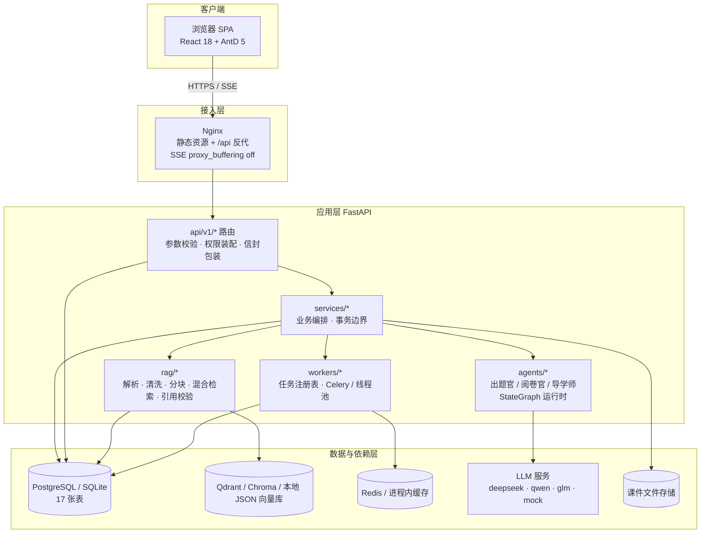
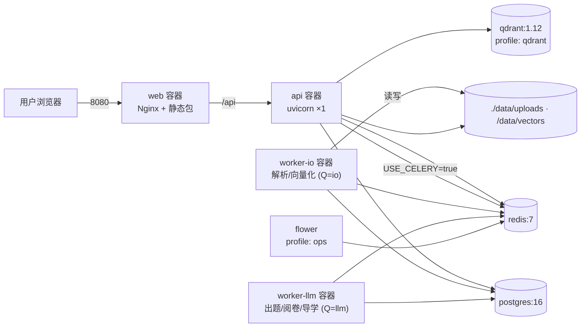
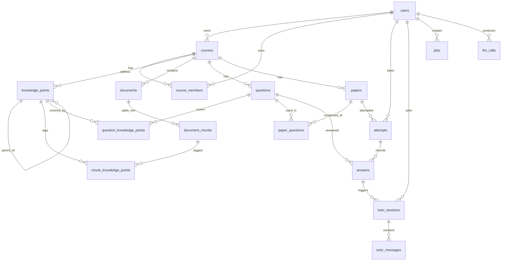
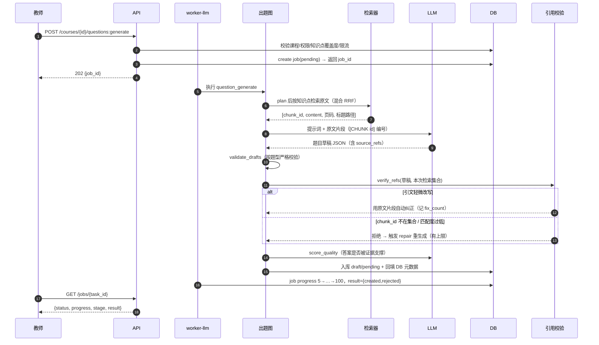
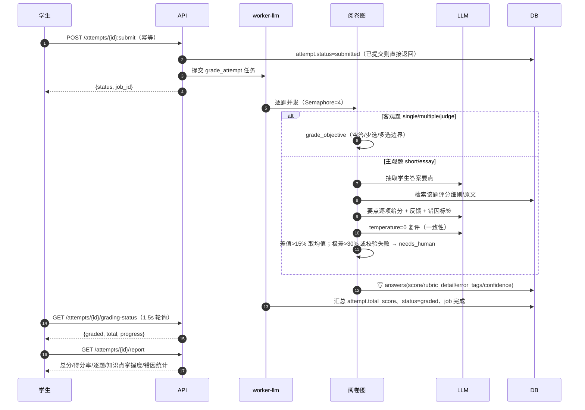
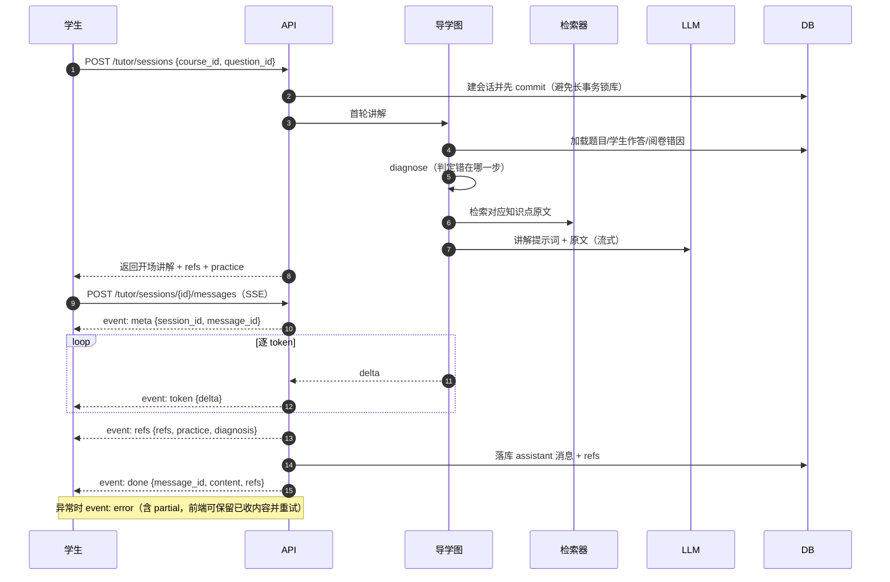
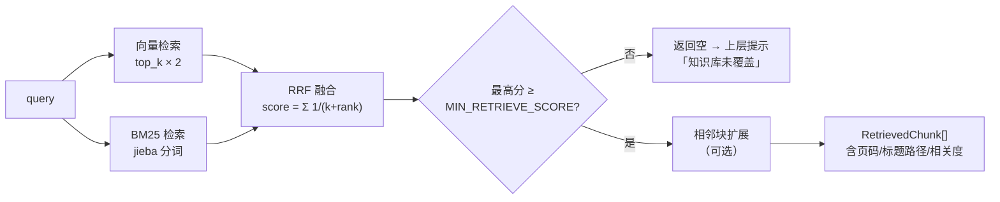

# 系统架构与流程（论文配图源文件）

> 全部图表使用 Mermaid，可在 Typora / VS Code / GitHub 直接渲染；导出 PNG 后即可贴入论文。

## 1. 分层架构

设计约束：

- 路由层零业务逻辑；层间只传 Pydantic 模型（禁止裸 dict）
- 每个外部依赖都有降级实现（见 README「降级矩阵」）
- 长耗时操作（解析/出题/阅卷）一律异步任务化，接口只返回 `job_id`

## 2. 部署拓扑

单机演示可直接 `uvicorn` + `vite dev`（SQLite + 本地向量 + mock LLM），不需要上面任何容器。

## 3. 数据模型（ER）

关键字段（与 `app/db/models/` 一致）：

| 表 | 关键字段 | 说明 |
|---|---|---|
| `documents` | `status(pending/parsing/ready/failed)`、`sha256`、`chunk_count`、`meta` | sha256 去重；`meta.ocr_pages` 标记扫描页 |
| `document_chunks` | `content`、`page_no`、`heading_path`、`token_count`、`meta` | 向量库只存 id，原文永远以 DB 为准 |
| `questions` | `type`、`answer`、`rubric`、`source_refs(JSON)`、`quality(JSON)`、`status` | `source_refs` 是防幻觉核心证据 |
| `answers` | `student_answer(JSON)`、`score`、`rubric_detail`、`error_tags`、`needs_human`、`confidence` | 主观题要点式给分明细 |
| `jobs` | `task_id`、`progress`、`stage`、`attempts`、`heartbeat_at`、`payload` | 前端轮询；超时可重试 |
| `llm_calls` | `scene`、`model`、`prompt_ver`、`latency_ms`、`tokens`、`success` | 论文性能章节数据源 |

## 4. 出题官时序

## 5. 阅卷官时序

## 6. 导学师时序（SSE）

## 7. 混合检索流程

